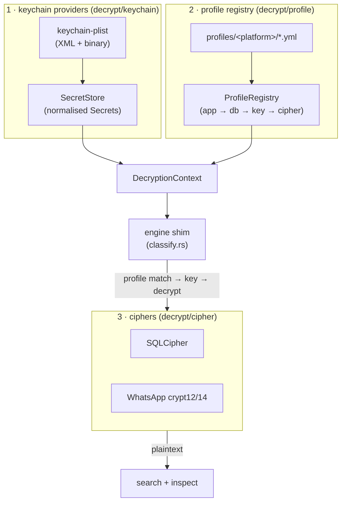
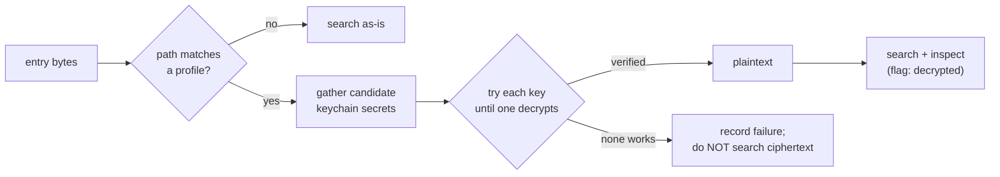

# Database decryption

`mf-scan` can decrypt encrypted app databases inside an acquisition ZIP using
keys from a keychain/keystore dump, then search and `--inspect` the **plaintext** —
so a Signal or SQLCipher database is searched as if it were never encrypted.

This document describes the design, the supported formats, the profile schema, the
provenance it records, and — importantly — what is and is not validated.

---

## Scope and the hard constraint

Decryption only works on acquisitions whose **keychain/keystore has already been
decrypted** by the acquisition tool (a full-file-system dump from GrayKey,
Cellebrite, a `checkm8`/jailbreak extraction, etc., which emits a decrypted
`keychain.plist`/JSON).

You **cannot** decrypt a raw on-device `keychain-2.db` offline: its items are
wrapped by the Secure Enclave / device UID key, which never leaves the device. So
`mf-scan` *consumes* an already-decrypted keychain dump — it does not break the
keychain itself.

---

## Architecture — three decoupled layers + an engine shim



Each layer is independent, so the framework is *scheme-agnostic*:

1. **Keychain providers** (`src/decrypt/keychain/`) normalise any dump format into a
   `SecretStore` of `Secret`s (the standard iOS SecItem attributes: `acct`, `svc`,
   `agrp`, `labl`, `pdmn`, `v_Data`). Adding a source = adding one
   `KeychainProvider`. Today: `keychain-plist` (XML **and** binary plist, via the
   pure-Rust `plist` crate) — covers iLEAPP, GrayKey, and any standard SecItem
   export.
2. **Profile registry** (`src/decrypt/profile.rs`) loads per-app YAML from
   `profiles/{ios,android}/*.yml`. A profile names the database, how to locate its
   key in the dump, and the cipher. Adding a target = adding one file.
3. **Ciphers** (`src/decrypt/cipher/`) implement the `DbDecryptor` trait, one per
   scheme. Today: **SQLCipher** and **WhatsApp crypt12/14**.

The **engine shim** (`src/ops/search/classify.rs`) consults the `DecryptionContext`
once per entry: if a profile matches the entry's path, it tries each candidate key
until one decrypts, then hands the plaintext to the normal search/inspect pipeline.

---

## Per-entry pipeline



The **try-each-candidate** loop is what gives forensic robustness: a profile's
match criteria may select several keychain items, so each is tried until one
decrypts and (where the cipher supports it) cryptographically verifies. A
profile-matched entry that cannot be decrypted is **recorded as a failure and not
searched** — its ciphertext holds no meaningful content.

**The `-wal` sidecar.** A targeted database's uncommitted changes live in its
`-wal`. Its committed frames are applied to the *ciphertext* before decrypting:
SQLCipher and the Find My cipher write pages to the WAL already encrypted, and the
WAL's checksums cover those encrypted bytes, so only the encrypted image can be
replayed and checked. If the replayed image does not decrypt, the main file alone is
tried, so a damaged WAL never hides the rest. The summary says `-wal replayed`, and
the report records `wal_replayed: true`.

Matches found in decrypted content are flagged `decrypted` in the output (txt
`[decrypted]`, a `decrypted` field in JSON/CSV); their offsets are positions in the
*plaintext*, so the archive byte offset is set to the entry's data start (as for
DEFLATE).

---

## Keychain sources and auto-detection

Keys come from:

- **A dump beside the archive** — by default, `mf-scan` scans the archive's
  directory for a file named `*keychain*` or `*keystore*` (the common forensic
  layout: `case.zip` next to `keychain.plist`, or an Android extraction next to
  `<serial>_android_keystore.zip`). A zip is opened and its members tried, so a
  zipped dump needs no unpacking. This is the usual path; no flag needed.
- **`--keyfile FILE`** — point at a dump explicitly (repeatable). A parse failure
  here is reported (you named the file); auto-detected non-matches are silent.
- **`--no-decrypt`** disables both.

Decryption is **on by default** when a dump is present. `--platform ios|android`
limits which profiles are considered.

Dump formats read:

| Format | Provider | Mapping onto a secret |
|---|---|---|
| iOS keychain plist (XML or binary; `genp`/`inet`/`keys`/`cert`) | `keychain-plist` | `svce`/`acct`/`agrp`/`labl`, as strings or data; value `v_Data` |
| Android-Keystore JSON (keyed by package) | `android-keystore-json` | package → access group, `key_name` → account, `description` → label, `result_type` → service; value `decrypted_data` (hex) |

In the Android dump, only items with `decrypted_data` carry a key (`Key Not Found`
items are dropped). A profile selects an app's keystore items by
`access_group: <package>`, the same field that selects an iOS app's keychain items.

A profile may cover a whole folder (`databases/*.db`). A file there that is an
ordinary SQLite database is searched as it is, not reported as a failed decryption.

---

## Profile schema

```yaml
name: signal-ios            # stable id (used in provenance)
app: Signal                 # display name
platform: ios               # ios | android — must match the folder
description: ...

db:                         # exactly one of:
  glob: "*/grdb/signal.sqlite"   # wildcard (*, ?), any depth
# path: "App/db.sqlite"          # exact internal path

key:
  encoding: raw             # raw | hex | base64 | passphrase
  keychain:                 # locate the key in the dump (each field optional = wildcard)
    service: TSKeyChainService
    account: OWSDatabaseCipherKeySpec

cipher:
  algorithm: sqlcipher      # see "Ciphers" below
  # …scheme-specific knobs…
```

Platform is both the folder **and** an in-file field; the loader rejects a profile
filed under the wrong platform folder. Files starting with `_` (and top-level
files like `profiles/_example.yml`) are treated as templates and skipped.

See `profiles/_example.yml` for the fully-annotated template.

---

## Ciphers

### SQLCipher (`algorithm: sqlcipher`)

Page-based AES-256-CBC with a per-page HMAC. Knobs (defaults follow SQLCipher 4):

| key | default | notes |
|---|---|---|
| `page_size` | 4096 | |
| `kdf_iter` | 256000 | SQLCipher 3 = 64000 |
| `hmac` | sha512 | sha1 / sha256 / sha512 (v3 = sha1) |
| `kdf` | sha512 | KDF PRF hash |
| `use_hmac` | true | |
| `plaintext_header_size` | 0 | bytes of page 1 kept in the clear (`cipher_plaintext_header_size`; Signal and Session iOS use 32) |

Key derivation: `key = PBKDF2(passphrase, file-salt, kdf_iter)`; a raw key is used
directly (a 48-byte raw key is `key‖salt`, the Signal keyspec form). The HMAC key is
`PBKDF2(key, salt⊕0x3a, 2)`. Page-1 HMAC verifies the key (a mismatch is treated as
a *wrong key*); the result's `verified` flag reflects this. Page 1's HMAC covers
the page from the end of the salt (or of the plaintext header), not from byte 0.

With a plaintext header the file holds no salt, so the key must carry it: a 48-byte
raw key spec. A 32-byte key or a passphrase is refused with that reason.

### Page-level AES-OFB (`algorithm: page-aes-ofb`)

Used by Apple's Find My daemons (`searchpartyd`, `findmylocated`,
`findmybeaconingd`). No knobs: the page size and reserve come from the header.

- Header bytes 16 to 23 (page size, versions, reserve = 12) are stored in the clear.
- Each page's last 12 bytes are a nonce, stored in the clear.
- The rest of the page is AES-256-OFB, IV = page number (little-endian u32) ‖ nonce.
- The key is the raw 32-byte value of a keychain item in the daemon's access group;
  its service names the store (`Observations`, `KeyDatabase` for
  `ItemSharingKeys.db`, `CloudKitCache` for `CloudStorage_CKRecordCache.db`, …).

Nothing authenticates the pages. The key is checked by page 1, whose first 16 bytes
must decrypt to `SQLite format 3\0` (a wrong key passes with probability 2⁻¹²⁸), so
`verified` means the key is right, not that every page is intact.

### WhatsApp crypt12/14 (`algorithm: whatsapp-crypt`)

AES-256-GCM over a zlib-compressed SQLite database. Knobs:

| key | default | notes |
|---|---|---|
| `iv_offsets` | `[8, 51, 67, 191]` | candidate 16-byte IV offsets |
| `zlib` | true | inflate the decrypted payload |

The crypt14 header is a variable-length protobuf, so the IV offset is not fixed.
Rather than parse the protobuf, the decryptor **tries each candidate IV offset and
relies on the GCM authentication tag** to confirm the right one (a false accept is
~2⁻¹²⁸). That GCM verification is the `verified` flag. Key derivation is WhatsApp's
"backup encryption" HKDF-SHA256 over the key material.

---

## Provenance (chain of custody)

Every decryption attempt is recorded:

- **stderr summary** — a `── decryption ──` block: per database, decrypted (with the
  key's service/account/source) or failed (with the reason).
- **Scan report** (`*-report.json`) — a `decryptions[]` array with, per entry: the
  profile, app, `verified` flag, the secret's source/service/account, and the
  **SHA-256 of both the ciphertext and the plaintext** (attesting exactly which
  encrypted bytes became which plaintext). `RunInfo` also records the `keychains`
  used and the `platform`.

---

## Getting decrypted databases out

| Want | Command | Output |
|---|---|---|
| decrypted copies in a folder | `find`, `grep` or `app export` with `--export DIR` | each original, its `-wal`/`-shm`, and `name.decrypted.ext` beside it |
| the whole acquisition with decrypted copies | `mf-scan decrypt SOURCE --to OUT.zip` | one `.zip` and its `.sha256` sidecar |
| only a list of what decrypts | `mf-scan decrypt SOURCE` | nothing written |

A decrypted copy is named `.decrypted` before the extension (`signal.sqlite` →
`signal.decrypted.sqlite`), so tools still open it by type. It already includes the
committed `-wal` frames, so it is complete on its own. In an export report it is
recorded with the original's internal path, its own hashes, and a `derived` note
saying how it was decrypted (profile, key, `-wal replayed`). A database that should
have had a copy but did not decrypt is listed under `undecrypted` in the export report,
with the reason, and printed on stderr; its original is still exported. A `-wal` that
exists but cannot be read is never silently skipped: the decryption records
`wal_error`, and the summary says `-wal NOT applied`.

**`decrypt --to`.** When the source is a plain zip (a full-filesystem acquisition),
the output begins as a byte-for-byte copy of it. Every original member keeps its
offset, compression, CRC and timestamps, and its central-directory record is kept
verbatim, then the decrypted copies are appended. Nothing is decompressed, so a
20 GB acquisition took 3.5 minutes. Any other source (folder, tar, backup, or a zip
holding an iOS backup) is re-packed STORED, each file with its own timestamp. Each copy
takes its original's modification time. `_mf-scan/decryption.json` inside the archive
lists every copy (both hashes, how it was decrypted) and every database that failed,
with the reason. The run exits 1 if any targeted database failed.

The decrypted copies' DOS time field is written in UTC, as in `backup rebuild`, and their
exact UTC time is in the Info-ZIP extended timestamp. An acquisition may have written its
own DOS fields in local time. The two then differ by the time-zone offset, while the
extended timestamps agree.

---

## CLI examples

```bash
# Keychain dump sits next to the archive — auto-detected, nothing to configure:
mf-scan grep "needle" case.zip

# Point at a dump explicitly, scope to iOS profiles:
mf-scan grep "token" case.zip --keyfile keychain.plist --platform ios

# Plain grep, no decryption:
mf-scan grep "needle" case.zip --no-decrypt

# Export one app's databases with their decrypted copies beside them:
mf-scan find case.zip --path '*grdb/signal.sqlite' --export out/

# The whole acquisition, plus each decrypted database, as one zip:
mf-scan decrypt case.zip --to case.decrypted.zip
```

---

## ⚠ Validation status

Every cipher is covered by encrypt↔decrypt round-trip, tamper and wrong-key tests.
Validation against real evidence, an iPhone full-filesystem extraction (December
2025) with the acquisition tool's keychain dump:

- **SQLCipher**: validated. Signal (`signal.sqlite` and its encrypted `-wal`) and
  Session (`Session.sqlite`) decrypt with every page's HMAC verifying, and their
  message tables read back.
- **SQLCipher with an Android-Keystore passphrase**: validated on a Samsung Galaxy A53
  extraction and its keystore dump. Nine Samsung system databases (Rubin, Device
  Quality Agent, Network Diagnostic, slocation) decrypt with every page HMAC
  verifying, in all three copies Android keeps (`/data/data`, `/data/user/0`,
  `/data_mirror`).
- **Page-level AES-OFB**: validated. All 9 Find My databases decrypt with their
  `-wal` replayed. An independent Python implementation produced the same SHA-256
  for each, and SQLite's `PRAGMA integrity_check` returned `ok` on all of them.
- **WhatsApp crypt14**: not yet validated. Confirm against a genuine `.crypt14` +
  `key` file.

Known gaps / follow-ups:

- **WhatsApp key sourcing.** On Android the key is the `key` *file* in the
  acquisition filesystem, not a keystore dump — so the WhatsApp profile needs that
  file's bytes placed into the supplied dump until a "key from an archive file"
  provider is added.
- **crypt15** (64-digit passphrase) is not implemented.
- **Cellebrite-specific** keychain exports that differ from the standard SecItem
  plist need a real sample to add a dedicated provider.
- **Shipped profile identifiers** for Signal, Session and Find My were read from the
  real keychain above. Older app builds may use other names (Signal used
  `TSKeyChainService` / `OWSDatabaseCipherKeySpec`), which the profiles do not match.
- **Android apps whose key the dump lacks.** The A53 dump reports `Key Not Found` for
  Signal (`org.thoughtcrime.securesms`), so its database cannot be decrypted from it.
- **EncryptedSharedPreferences.** The Android dump also holds Tink keysets that
  protect `EncryptedSharedPreferences` XML files. Decrypting those files is not
  implemented.

---

## Extending

| To add… | Do this |
|---|---|
| a **new app** | add `profiles/<platform>/<app>.yml` (no code) |
| a **keychain dump format** | add a `KeychainProvider` in `src/decrypt/keychain/` and register it |
| a **cipher** | add a `DbDecryptor` in `src/decrypt/cipher/` + a `CipherSpec` variant + one dispatch arm |
