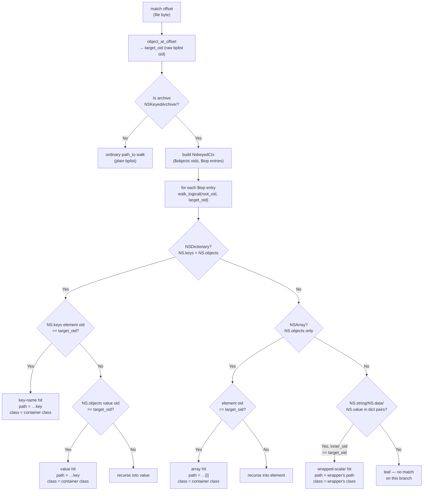

# Inspectors (`--inspect`)

An *inspector* turns a raw match offset into a meaningful location inside a
recognised file format. Inspection is opt-in (`--inspect`) and never changes the
match itself — it only adds `format` + `context` to the output.

## Format detection (header-first)

`inspect::detect` chooses a format using the **content header first**, then the
file extension as a fallback. Forensic file names are often wrong, renamed, or
absent, so a reliable in-content signature is trusted over the extension; the
extension only decides formats that have no magic bytes (JSON, CSV, TXT).

| Detected as | By magic (header) | By extension |
|---|---|---|
| SQLite | `SQLite format 3\0` | `.sqlite .sqlite3 .db .sqlitedb` |
| plist (binary) | `bplist00` | `.plist` |
| plist (XML) | `<?xml …` containing `<plist`/`DOCTYPE plist` | `.plist` |
| XML | `<?xml …` (non-plist) | `.xml` |
| media (image/video/audio) | per-format signatures — JPEG/PNG/GIF/TIFF/HEIF/…, MP4/MOV/MKV/WebM/…, MP3/FLAC/OGG/WAV/… | `.jpg .png … .mp4 … .mp3 …` |
| JSON | — | `.json` |
| CSV | — | `.csv` |
| TXT | — | `.txt .log .text` |
| ABX (Android Binary XML) | `ABX\0` | — |
| SEGB (Biome streams, iOS/macOS) | v2: `SEGB` at 0 with an entry count that fits; v1: `SEGB` at 52 with an end offset that fits | — |

A file that matches no inspector is reported as a plain match (no `context`).

### Identify-only formats
Under `inspect/identify/`, one file per category, built on `classify_inspector!`:
the format is named from a signature and the match is reported as `[format]`
(`"format"` with an empty `context` in JSON), with no position. The rule for adding
one: a signature at a fixed place in the first 4 KiB (`detect`, which must decide
from at most `inspect::HEAD_LEN` bytes even when given more) or in the last 8
bytes (`detect_tail`, only for a format with no usable start), no extension, and a
check on real files that it matches only that format. They are registered before
the media formats, some of whose checks are shorter. Where a media signature alone was
weak, it is backed by the format's own fields: MP3 without an ID3 tag needs two
consecutive valid frame headers, BMP its reserved words and DIB header size, ICO a
valid directory entry (its 4-byte magic is also the integer 256).

PEM, vCard and iCalendar are text: a match resolves to its line and column, under
their own format name (category `text`). OpenPGP armour (`-----BEGIN PGP …`) is
not PEM and is left to the text inspector.

Detection order: the start of the file, then its end, then the extension. `--type`
reads the first 4 KiB and, only when that names nothing, the last bytes
(`engine::type_from_ends`), so media and most files cost no extra read. A LevelDB
log whose first record does not fit in the first 4 KiB is not named.

| Format | Signature |
|---|---|
| `leveldb` (own inspector: logs and manifests resolve) | `MANIFEST-*`, `.log`: no magic, the first log record's masked CRC-32C matches its bytes; `.ldb`/`.sst` tables: the footer magic `57 FB 80 8B 24 75 47 DB` as the last 8 bytes |
| `lmdb` | meta flag `0x08` at 10, `DE C0 EF BE` + version 1 at 16 |
| `sqlite-wal` | `37 7F 06 82`/`83` + version 3007000 |
| `sqlite-shm` | version 3007000 (`18 E2 2D 00`) at 0 and at 48 (the header's two copies) |
| `tracev3` / `dsc` | header chunk tag `0x1000`, sub-tag `0x11` / `hcsd` |
| `sqlite-journal` | `D9 D5 05 F9 20 A1 63 D7` |
| `binarycookies` | `cook`, page count, page sizes, first page `00 00 01 00` |
| `bom` | `BOMStore` |
| `zip` / `gzip` / `bzip2` / `xz` / `zstd` / `7z` / `tar` / `lz4` / `lzfse` / `aea` | `PK\3\4` (or empty `PK\5\6`) / `1F 8B 08` / `BZh`+digit+block magic / `FD 37 7A 58 5A 00` / `28 B5 2F FD` / `37 7A BC AF 27 1C` / `ustar` at 257 / `04 22 4D 18` / `bvx1`,`bvx2`,`bvxn`,`bvx-` / `AEA1` |
| `elf` / `macho` / `dex` / `hermes` | `7F ELF`+class / `FEEDFACE`, `FEEDFACF` either order (not fat `CAFEBABE`, shared with Java) / `dex\n`+3 digits+NUL / `C6 1F BC 03 C1 03 19 1F` |
| `pdf` / `ole` / `vcard` / `icalendar` / `pem` | `%PDF-` / `D0 CF 11 E0 A1 B1 1A E1` / `BEGIN:VCARD` / `BEGIN:VCALENDAR` (any case, optional BOM) / `-----BEGIN ` but not `-----BEGIN PGP ` |
| `chromium-cache` | `30 5C 72 A7 1B 6D FB FC` |

Checked on the Pixel 9a, Samsung A53 and iPhone 14 Plus file systems: each matched
only files of its format. Not seen there, so taken from the format's specification:
`sqlite-journal`, `xz`, `7z`, `lz4`, `icalendar`.

## Type and category (`--type`, media skip)

Every inspector also declares a `name()` (its format tag, e.g. `sqlite`, `jpeg`)
and a `category()` (a coarse group: `database`, `structured`, `text`, `media`).
`--type` accepts either, so `--type sqlite` selects one format while `--type
media` selects every image/video/audio format at once. The **media skip** (on by
default, off with `--include-media`) is just this machinery excluding the `media`
category — so there is no separate, duplicated media extension list. Media
inspectors are *classification only*: they recognise the format (so `--type` and
the skip work) but do not resolve an offset, so they add no `context`. They live
in their own category folder `inspect/media/`, one file **per family**
(`image.rs`, `video.rs`, `audio.rs`), built on the shared `classify_inspector!` macro in
`inspect/mod.rs`; the folder's `mod.rs` is the category aggregator. The top-level
`inspect/` therefore holds the file-type inspectors, the module root, and three
shared parts: `detect.rs` (which inspector a file belongs to), `nested.rs` (what a
value inside a file holds: a SQLite BLOB, a SEGB entry's data) and `value_diff.rs`.

## What each inspector resolves

### TXT
Counts newlines up to the offset → 1-based **line** and (byte) **column**.

### JSON
A single-pass scanner tracks the path stack and reports the **key path** of the
value (or key) containing the offset, e.g. `$.users[3].token`. (serde gives a
parsed tree but no byte spans, so this is hand-rolled; it locates, it does not
validate.)

### XML
Uses quick-xml's event byte positions to track open elements and reports the
**element path**, e.g. `/plist/dict/string`. Attribute-level resolution is a
future refinement.

### CSV
A quote-aware scan (RFC 4180: `"`-quoted fields, `""` escapes) reports the 1-based
**row** and **column** plus the **header** name (the column's value in row 1).
Commas/newlines inside quotes do not miscount.

### plist (XML and binary)
Both encodings resolve to the same dict-key / array-index **path**, e.g.
`$.Account.Servers[1]`.

- XML plists are walked as XML, tracking `<key>` names and array positions.
- Binary plists (`bplist00`) are parsed via the trailer + offset table: the
  object whose byte span contains the offset is located, then a path to it is
  found by walking the object graph from the root.

#### NSKeyedArchiver serialised plists

Binary plists produced by `NSKeyedArchiver` (the standard Cocoa object-graph
serialiser) store a **flattened `$objects` array** rather than a nested dict tree.
All cross-references are UIDs — integer scalars (bplist marker high-nibble `0x8`)
that are indices into `$objects`. Detection is header-first: the root dict must
contain `$archiver == "NSKeyedArchiver"`.

The resolver (`src/formats/inspect/nskeyed.rs`) walks the UID graph from every `$top`
entry to the object that contains the matched bytes, reconstructing the logical
path (e.g. `$.root.prefs.token`). Four hit kinds are handled:

| Hit kind | Description | Example path |
|---|---|---|
| Direct value | Object is a plain scalar (string, number, data) in an NSDictionary or NSArray | `$.root.title` |
| Array element | Object is an element of an `NS.objects`-encoded NSArray | `$.root.items[2]` |
| Dict key name | The match landed on a dictionary **key** string, not a value | `$.root.NEEDLE_KEY` |
| Wrapped scalar | Object is the inner scalar of a Foundation wrapper (`NS.string` / `NS.data` / `NS.value` field in an `NSMutableString`, `NSData`, or `NSValue` object) | `$.root.s` |

The **Foundation class name** of the logical object that directly holds the matched
value is reported in the `detail` JSON as `"class"` (e.g. `"NSMutableString"`,
`"NSDictionary"`, `"NSArray"`). The field is omitted when the `$class` entry
cannot be read. For a wrapped scalar the class is the *wrapper's* class; for a
container hit it is the *container's* class.

```
detail: {
  "path":     "$.root.prefs.token",
  "archiver": "NSKeyedArchiver",
  "class":    "NSDictionary"        // omitted when unresolvable
}
```

#### NSKeyedArchiver `$objects`/UID resolution — flow



### SQLite
Parses the database header (page size), then the b-tree:

- If the offset lands in a **live table-leaf cell**, it resolves to
  `table + rowid + column` (column names come from the `CREATE TABLE` SQL in the
  schema; the cell's record format gives the column byte spans). The column's
  storage type is shown next to its name — `column: body [TEXT]` — derived from
  the record serial type (`NULL`/`INTEGER`/`REAL`/`TEXT`/`BLOB`).
- When the matched cell is a **BLOB**, its complete bytes (overflow pages
  included) are run back through the same detection: first by signature (a
  `bplist`, XML plist, SQLite, media…), then, for content with no signature, by
  structure (the whole BLOB parses as JSON, then as a protobuf message). The
  matching inspector resolves the match inside the blob, and the result is
  attached as `blob_format` + `blob_context` (json) / appended to the summary
  (`… blob: bplist  key: $.Account.Servers`). A structural result adds
  `blob_detection: "structure"` and "(by structure)": a lead to export the
  database and decode the value with its real schema, not a certainty. No
  SQLite-specific format parsing is duplicated — it reuses the inspector registry.
- A match in a database's **`-wal`** is resolved through the main database: the
  WAL frame gives the page, and the page is read in the database with that frame
  applied (`-wal frame F, page P: table: …`).
- Otherwise — freelist pages, free blocks, interior/overflow pages, unallocated
  space — it reports just `page` + `offset-in-page`.

This split is intentional: forensically, "which page/offset" is still useful when
a byte isn't part of a current row (e.g. a deleted record in free space).

### Protobuf
No schema (`.proto`) is needed: the wire format describes its own structure. A
match resolves to a **field path** (`4.4.2.1` = field 1 of field 2 of field 4 of
field 4), its wire type, and the value (string, number, bytes, nested message).

- **Detection.** Protobuf has no signature, and a file name proves nothing, so
  only structure is used: a matched file nothing else claims, and a BLOB with no
  signature, are tried as protobuf. The bytes must parse completely by `protoc --decode_raw`'s rule: valid wire
  types, groups balanced, a 32-bit tag, field numbers 1 to 2^29 − 1 (the
  specification's limits). Short random runs sometimes pass (about 1% of random
  16-byte values, 0.002% of 256-byte ones), which is why a structural result is
  always marked "(by structure)".
- **Text or message.** A length-delimited value can be a string, bytes, or a
  nested message. A value that parses as a message is one, unless it is also
  printable text with no length-delimited field of its own: then it is a string.
  (`protoc` always prefers the message and turns a word like `Hahahaha` into
  number fields.) The same rule decides whether a whole file or BLOB is protobuf:
  plain text that merely parses is not. This is a choice between two valid
  readings, so every value on the match's path that reads both ways is listed
  (`ambiguous` in JSON, `(field 4.4.2 also valid as text)` in the summary).

### LevelDB logs and manifests
A match in a log (`*.log`) resolves to its **record**, the entry's **sequence
number**, **put** or **delete**, and the **key** and **value**; in a manifest
(`MANIFEST-*`), to the version edit field (comparator, new file with its key range,
compact pointer, …). Records split across 32 KiB blocks are reassembled. A record is
read only when its CRC verifies, as LevelDB's reader requires: bytes left from an
earlier use of the file are not shown as records. Tables (`.ldb`) are identified.
Checked on the 1,029 logs and manifests of two Android devices.

### uuidtext (unified logs)
A match in a `uuidtext` file resolves to the **format string** holding it, its
offset in the binary's string space (`string_offset`, the value a `.tracev3` entry
uses to refer to it) and the **binary** that logs it (the file's footer). Checked on
the 1,165 `uuidtext` files of an iPhone.

### typedstream (iMessage `attributedBody`)
Apple's `NSArchiver` format. In `sms.db`, the `message.text` column can be empty and
the message only in `attributedBody`: a match there resolves through the SQLite
BLOB to the **objects** holding the string (`NSMutableAttributedString /
NSMutableString`) and the **text**. Little-endian streams (`\x04\x0bstreamtyped`)
only; reading stops at an array, struct or pointer type, which iMessage text does
not use. Checked on the `sms.db` of three iPhones.

### MMKV
Tencent's key-value store (Discord, WeChat, many React Native apps). No signature,
so found **by structure** (entries framing the data exactly, UTF-8 keys) as a lead;
on the test devices it named 8 stores and nothing else. A match resolves to the
**key**, the **value** (a string, else a number), the **entry** number, and the
later entry that **supersedes** it: MMKV appends, so old values stay in the file.

### ABX (Android Binary XML)
Android 12+ writes many system XML files (`packages.xml`, runtime permissions,
settings) as ABX. A match resolves to the **element path**, with a 1-based index
among same-named siblings (`/packages[1]/package[37]`), and to the **attribute**
and its typed value (`@name  value: "com.example"`, ints, longs, booleans, bytes as
hex or base64) or the text (`text()`, `comment()`, …).

- **Format**: `ABX\0`, then one token per XML event (event in the low nibble, data
  type in the high one), big-endian numbers, strings as a u16 length and UTF-8,
  tag and attribute names interned. As written by Android's `BinaryXmlSerializer`.
- **Validation**: all 1,234 ABX files of the three Android test devices parse to
  their end with balanced tags.

### Realm
A match resolves to the **class** (table, shown without Realm's `class_` prefix),
the **property** and its type, the **object** key, and for a string or binary
property the **value**. Elsewhere: a class or property name (schema), a property's
data (other types), the object keys, Realm structure, or **free space**: bytes an
earlier version used, which Realm (copy-on-write) leaves until reused.

- **Detection.** `T-DB` at byte 16. An encrypted Realm is encrypted from its first
  byte, so it is not recognised.
- **Layout** from Realm Core's sources (as also read by the crush-forensics parser
  that iLEAPP and ALEAPP vendor): header with two top refs, arrays (`AAAA` +
  flags + 24-bit count), group → tables → spec (names, column keys) and cluster tree
  (object keys, one array per column), strings inline, as small blobs or as big
  blobs. File format 10 and later only; an older file is named with its version.
- **Validation.** The two Realm files of the test data (format 24) resolve byte for
  byte, but hold no object with a string value: the value decoding is checked on
  synthetic files only.

### SEGB
The segment files of Biome streams (`…/Biome/streams/…/local/<number>`). A match
resolves to the **entry** it falls in, with its state (`written`, `deleted`), its
time (UTC), whether the entry's CRC-32 matches its data, and, inside the data, what
the data is: usually a protobuf message (`data: protobuf (by structure)`, then its
field path).

- **Versions.** v2 (iOS 17 and later): 32-byte header, entries, then a trailer of
  16-byte records (end offset, state, time) at the end of the file. v1 (iOS 16 and
  earlier): 56-byte header, then records each with a 32-byte header (length,
  state, two times, CRC-32). Layouts from CCL Forensics' `ccl-segb` (MIT).
- **Validation.** v2 was checked on 528 real files from three iPhones: every
  written entry's CRC-32 matched, with state-4 records skipped as the reference
  reader does. No v1 file was available; v1 follows the reference reader. The CRC
  result is shown for every entry, so a wrong reading would show; on a deleted
  entry a mismatch may also mean its bytes were cleared.
- **States and times** are shown in the trailer's order (the on-disk evidence),
  not re-sorted by their times.
- **Detection** needs only the header (magic plus a valid count or end offset),
  so `--type segb` works from the first 4 KiB; whether the trailer fits the file
  is checked when the file is read.
- **Elsewhere in the file**: `file header`, `trailer record N`, `(entry header)`,
  or `outside any entry` (padding or unused space).

### Structure fallback for unclaimed files
A matched file that no inspector claims by signature or extension gets one more
try: if its whole content is JSON (starting with `{` or `[`), or else a protobuf
message, that inspector resolves the match, marked `"detection": "structure"` and
"(by structure)". This never affects `--type`, which classifies by signature and
extension only.

## The inspector API

Every format is an `Inspector` (the trait in `src/formats/inspect/mod.rs`):

```rust
pub trait Inspector: Sync {
    fn name(&self) -> &'static str;                  // format tag / --type value
    fn category(&self) -> &'static str;              // group, e.g. "media", "database"
    fn extensions(&self) -> &'static [&'static str]; // fallback detection
    fn detect(&self, content: &[u8]) -> bool;        // header/magic (preferred)
    fn inspect(&self, content: &[u8], offset: usize) -> Option<Inspection>;
    fn sidecars(&self) -> &'static [&'static str] { &[] } // associated files
}
```

Inspectors are zero-sized types listed once in `INSPECTORS`. The shared core lives
in `mod.rs` (the trait, the registry, dispatch and output) and `detect.rs` (the
detection order: header, then end of file, then extension, then structure); an
inspector only supplies its format specifics. The per-match
`Inspection { format, summary, detail }` carries the short `format` tag, the
labelled human one-liner (`summary`, used by the txt tag and csv `context`), and
the structured `serde_json::Value` (`detail`, used by json). Shared helpers
(`line_at`, `looks_like_xml`, `contains`) live in `mod.rs` and are documented so
inspectors reuse rather than duplicate them.

### Adding one

1. Copy [`inspector-template.rs`](inspector-template.rs) to
   `src/formats/inspect/<format>.rs` and `mod <format>;` it in `src/formats/inspect/mod.rs`.
2. Fill in `name` / `category` / `extensions` / `detect` / `inspect` (and
   `sidecars` if any). A *classification-only* media format needs no `inspect`
   body — use the `classify_inspector!` macro (see `src/formats/inspect/media/image.rs`).
   **Extensions are a last resort**: list one only when it is the format's
   standard, widely used extension (`.sqlite`, `.plist`, `.jpg`). Leave the list
   empty when the format has no common extension — protobuf, for instance, is
   saved under any name, so its extension list is empty and an extension would
   only add false claims.
3. Register it: add `&<format>::Foo` to `INSPECTORS` in `src/formats/inspect/mod.rs` —
   **list more specific formats first**, because `detect` (header) checks run in
   order (e.g. plist before generic XML).
4. Reuse shared helpers; add new ones to `mod.rs` with a doc comment.
5. Add a test, ideally against a committed fixture in `tests/fixtures/`.

### Sidecars (associated files)

A format declares the files exported alongside a match via `sidecars()` — suffixes
appended to the file name, e.g. SQLite returns `["-wal", "-shm", "-journal"]`.
`export` fetches them automatically (`inspect::sidecars_for`), so adding a format's
sidecars is one line in its inspector — `report/export/` needs no change.

## Coming in a future version

- **LevelDB tables** (`.ldb`): identified today; their uncompressed blocks hold
  readable keys and values (Chrome Local Storage), which could resolve like logs.
- **Unified logs** (`.tracev3`): identified today; decoding needs LZ4, the format
  strings from `uuidtext` and the shared cache.
- **UTF-16 search**: a literal's UTF-16 forms, as bplists store non-ASCII text.

